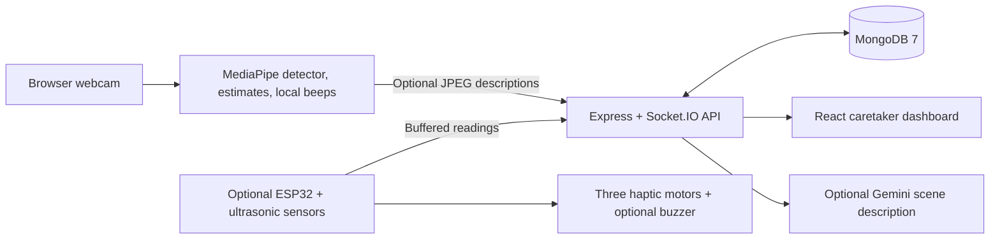

# Smart Mobility Aid

A prototype with two operating modes: **Camera Cane**, which uses a laptop webcam for local obstacle detection and directional sound, and **Hardware mode**, which connects the optional ESP32 ultrasonic-sensor aid to the same API and dashboard. Camera distances and scene descriptions are estimates; the project is intended to assist a white cane and does not replace it.

## Assumptions and scope

- The browser-based detector uses the locally bundled MediaPipe Tasks Vision package, EfficientDet-Lite0 model, and WASM files. After dependencies and these assets are present, object detection and beeps do not require Gemini or internet access.
- The initial camera focal length assumes a nominal 60-degree horizontal field of view. Use calibration for a camera-specific estimate. Object heights are typical assumptions in `frontend/src/cameraMath.js`, not measured dimensions.
- Gemini is optional and used only for advisory scene descriptions. If `GEMINI_API_KEY` is absent, the API returns a clearly labelled mock response. Camera sound alerts do not depend on the Gemini endpoint, API key, or internet.
- Camera frames are downscaled in the browser to at most 640 pixels and JPEG quality 0.7 before an explicit or periodic description request. They are sent to the backend and, when configured, the Gemini API. Do not enable descriptions for scenes you do not want to transmit.
- MongoDB may run locally or through the optional MongoDB 7 Docker Compose service. Seeded demo passwords are for local demonstration only and must be changed before deployment. Caretakers see assigned devices; administrators can see all devices.
- The hardware simulator generates simulated data, not sensor measurements. ESP32 firmware has not been compiled or exercised on physical hardware in this workspace.

## Architecture



## Run locally

1. Install Node.js LTS and start MongoDB locally, or use Docker from `backend/` with `npm run db:up`.
2. In `backend/`, create `.env` from `.env.example`, set a long random `JWT_SECRET`, then run `npm install`, `npm run seed`, and `npm run dev`. The seeded accounts are `admin@example.com` / `ChangeMe123!` and `caretaker@example.com` / `ChangeMe123!`.
3. In a second terminal, open `frontend/`, create `.env` from `.env.example`, then run `npm install` and `npm run dev`. Open the printed Vite URL. Use `http://localhost:5173` for webcam permission.
4. Sign in. Camera Cane is the default page. Allow camera access and press **Start camera + sound**; browser audio starts only after this gesture. The local detector assets are in `frontend/public/models` and `frontend/public/mediapipe`.
5. For hardware data, switch to **Hardware mode (ESP32)**. For simulated hardware records, sign in as admin, open **Demo**, and start the simulator. Simulated readings remain labelled as simulated.

### Gemini setup (optional)

Get a Gemini API key from Google AI Studio. Put it only in `backend/.env`:

```dotenv
GEMINI_API_KEY=your_private_key_here
GEMINI_MODEL=gemini-3.8-flash
```

Restart the backend after changing `.env`. The default model is `gemini-3.8-flash`, the current vision-capable Flash model in the [official model guide](https://ai.google.dev/gemini-api/docs/models/gemini); `GEMINI_MODEL` can override it. The endpoint uses Gemini's [structured JSON output](https://ai.google.dev/gemini-api/docs/structured-output) and validates it again with Zod. Never put the API key in a frontend file or commit a real `.env`. Without a key, scene description works in mock mode and is labelled as such. The camera detector and sound alerts continue locally.

### Camera calibration

1. Open **Camera Cane**, allow camera access, and press **Start camera + sound**.
2. Place one supported object in view at a measured distance. Select its class in **Distance calibration** and enter that known distance in metres.
3. Keep the object visible and press **Calibrate**. The app derives a focal-length estimate from the detected box height and saves it in this browser's local storage.
4. Set the alert distance with the slider. Its range is 0.5–20 m, with a 2 m default. Distances shown in boxes and descriptions are always marked estimated.

Calibration is only as reliable as the selected object's typical height, the detector box, and the known distance. Recalibrate after changing cameras or camera resolution.

## Five-minute viva demo

1. **0:00–0:40 — Start:** Sign in, open Camera Cane, allow webcam access, and press **Start camera + sound**. Point the laptop camera into a clear indoor space.
2. **0:40–1:30 — Calibrate:** Keep a person or supported object visible at a known distance, enter that distance, and press **Calibrate**. Explain that the displayed camera distance remains an estimate.
3. **1:30–2:00 — Set range:** Set the alert distance to 2.0 m. Point out the text status banner, overlay labels, detector FPS, and measured detection-to-sound scheduling time.
4. **2:00–3:10 — Local alerts:** Slowly move an object or volunteer toward the camera in a clear, controlled area. Show that the sound pulses become faster as the estimated distance falls, and that stereo position maps left, centre, and right to sound direction.
5. **3:10–4:10 — Describe:** Press **Describe surroundings**. With a backend Gemini key and internet, the page shows an advisory description; without a key it clearly labels the mock response. Scene description never triggers the safety beep.
6. **4:10–5:00 — Offline check:** Stop internet access after the detector is loaded and repeat the controlled approach. Show that local detection and beeping continue. Restore internet if you want to continue using Gemini descriptions.

Do not use this demonstration near traffic, stairs, or other hazards. The prototype is not validated as a mobility or safety device.

## Limitations

- **Monocular distance error:** one webcam cannot directly measure depth. Distance depends on assumed real object height, calibration, camera angle, and detection-box size; objects vary considerably.
- **Lighting and camera:** dim, backlit, blurry, moving, or occluded scenes can reduce detections. A camera change or resolution change can make calibration less useful.
- **Detector classes:** EfficientDet-Lite0 detects a fixed set of classes. Objects outside those classes may not be recognized.
- **Thin and transparent objects:** wires, poles, glass, and transparent objects can be missed or have unstable boxes.
- **Long range:** boxes occupy fewer pixels at distance, so distance estimates degrade as objects get farther away.
- **Not a replacement aid:** this is a software prototype and has not been validated for real-world navigation. It assists a white cane and does not replace it. Do not rely on it for safety-critical decisions.
- **Hardware:** ESP32 firmware sampling uses a short echo timeout and local haptics, but wiring and physical behavior still require bench testing. The firmware is optional and was not compiled or tested on hardware in this workspace.
- **Measured metrics:** the page displays FPS and detection-to-sound scheduling time measured at runtime with `performance.now()`. The latter is scheduling delay in the browser, not measured speaker-output latency. No fixed performance or accuracy result is claimed.

## API

| Method | Path | Access | Purpose |
|---|---|---|---|
| POST | `/api/auth/login` | Public | JWT login |
| GET | `/api/auth/me` | User | Current profile |
| POST | `/api/readings` | Device | Submit one reading or up to 60 |
| POST | `/api/alerts` | Device | Send hardware alert |
| POST | `/api/alerts/camera` | User | Store a throttled laptop-camera obstacle alert |
| POST | `/api/vision/describe` | User | Rate-limited Gemini or mock scene description |
| GET | `/api/devices/me/config` | Device | Fetch thresholds and haptic settings |
| GET/PATCH | `/api/devices`, `/api/devices/:id/config` | User | List devices / update configuration |
| GET | `/api/readings`, `/api/readings/stats` | User | History and hourly summaries |
| GET/PATCH | `/api/alerts`, `/api/alerts/:id/ack` | User | Filter and acknowledge alerts |
| POST | `/api/demo/start`, `/api/demo/stop` | Admin | Start/stop simulated records |
| GET | `/api/health` | Public | API and database state |

JWT-authenticated Socket.IO clients receive events only for their assigned devices (admins receive all devices). Socket.IO broadcasts `reading`, `alert`, and `device:status`. The service marks a device offline after 15 seconds without a request.

## Checks

Run `npm run lint` and `npm test` in both `backend/` and `frontend/`. Run `npm run build` in `frontend/`. Firmware compilation requires the Arduino IDE, ESP32 board support, and ArduinoJson; see `backend/firmware/WIRING.md` and the firmware example config. Every ultrasonic ECHO signal must go through the documented divider before reaching an ESP32 GPIO.


